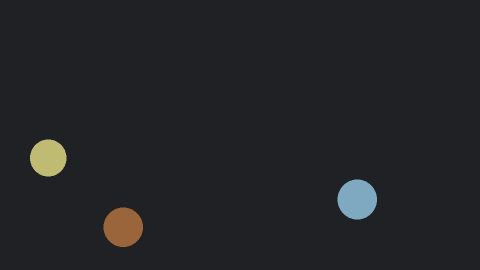
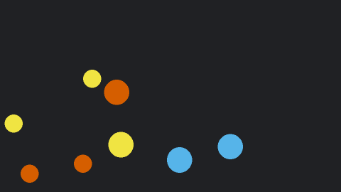
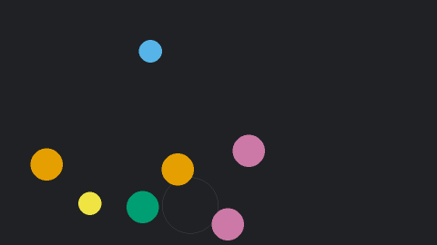

# BallStim

A small side project I made while getting to know PsychoPy and seeing what I could build with it. It draws coloured balls that drift, bounce, split and merge, at three levels of visual stimulation, and you can tune everything from a spreadsheet.

| low | medium | high |
|:---:|:---:|:---:|
|  |  |  |

## What it does

- Plays the animation live in PsychoPy, or exports it as an MP4.
- Three presets (low, medium, high), plus any versions you add yourself in `settings.xlsx`.
- Same settings and same seed always give exactly the same animation, live or exported.
- Every run saves a log of what happened and when (splits, merges, bounces, effects), so you can line it up with other data afterwards.
- An optional "wait for trigger" start: the screen waits for a key (5 by default, which is what a lot of MRI scanners send) before the animation begins.

## The three presets

**low**: 3 soft-coloured balls drift very slowly and gently "breathe". No splitting, no effects.

**medium**: faster and in full colour. Big balls that collide split into two small balls, and small balls of the same colour merge back together.

**high**: the fastest. Any two small balls can merge, and their colours mix like paint (red + yellow = orange). Collisions have a 50% chance of a ring ripple, and merges have a 50% chance of a short starburst.

### How the colours work

Every small ball is one "block" of red, yellow or blue. A big ball is two blocks, shown as their paint mix. Splitting and merging only regroup blocks, so the colour balance never drifts and the number of balls always stays between the starting number and double it. I liked that this kept the busy preset from slowly turning into one colour.

## Running it

You need [PsychoPy](https://www.psychopy.org/download.html). The standalone install already includes everything else it uses (openpyxl, Pillow, imageio-ffmpeg).

**Windows:** double-click `Start BallStim.bat`. It looks for PsychoPy in the usual install folders.

**Anywhere else (or if the .bat can't find PsychoPy):** open `app/ballstim.py` in the PsychoPy Coder and press Run.

A form pops up. Pick a setting row and either:

- **Play now** plays on this screen. Press Escape to stop early.
- **Export video** saves an MP4 in the `exports` folder.

You can change the main numbers in the form for a single run. Those changes go into that run's record but are not saved back to the spreadsheet.

There is also a command line, which I used for testing:

```
python app/ballstim.py --row high --mode export --no-form
python app/ballstim.py --row low --mode play --windowed --no-form
```

## Changing the settings

`settings.xlsx` holds every setting, one row per version of the animation. To make your own, copy a row, give it a new name, change the values, then save and close the file. It shows up in the dropdown next time. The Guide sheet explains every column, and hovering over a column heading on the Settings sheet shows a short reminder.

## Records

Every run saves two files:

- `..._events.csv`: the time of every split, merge, bounce, ripple and starburst, and how many balls were on screen afterwards
- `..._settings.json`: the exact settings and seed used (live runs also record dropped frames)

Live runs save to `logs/`. Video exports save next to the video in `exports/`.

## Repeatability

The animation moves forward in fixed 1/60-second steps from the seed, so a slow computer might skip drawing a frame but it never changes what happens. Change the seed to get a different version that is just as repeatable.

## Design notes

- The default colours are the Okabe-Ito colour-blind-safe palette. If you change them, it is worth checking them in a colour-blindness simulator.
- There are no full-screen flashes. The background never changes during a run, and the ripples and starbursts are small and local.
- On the light background the balls get a thin dark outline so pale colours (yellow especially) stay visible.

## Files

```
Start BallStim.bat   Windows launcher
settings.xlsx        all the settings
app/                 the program
  ballstim.py        start here: the settings form and command line
  ballstim_engine.py the animation logic (shared by playback and export)
  player.py          live playback in PsychoPy
  export_video.py    MP4 export
  settings_io.py     reads the spreadsheet, writes the run records
docs/                the GIFs in this README
```

## Licence

MIT. See [LICENSE](LICENSE).
